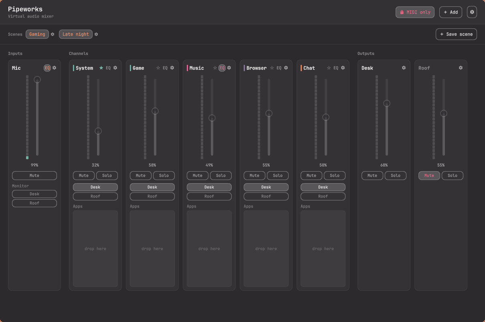
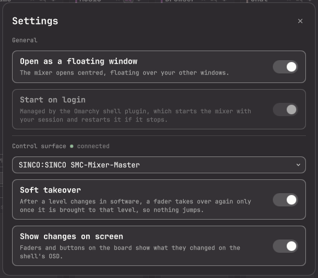
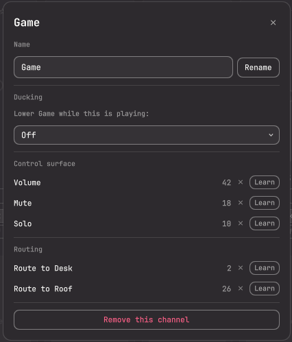
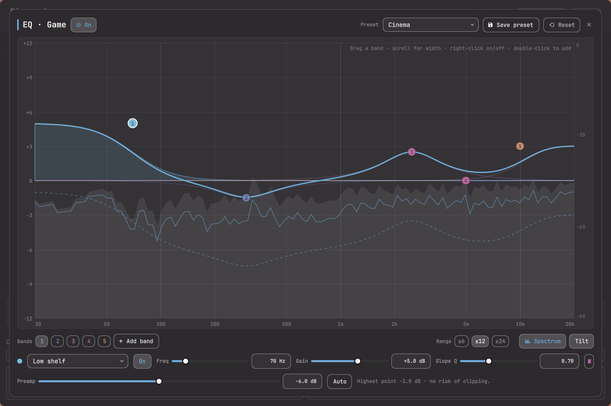
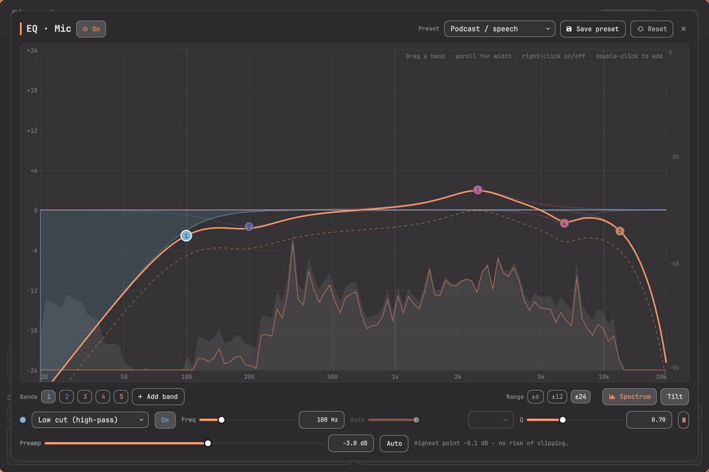
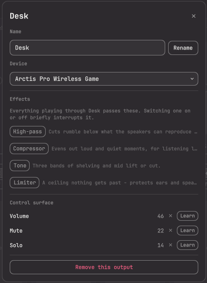
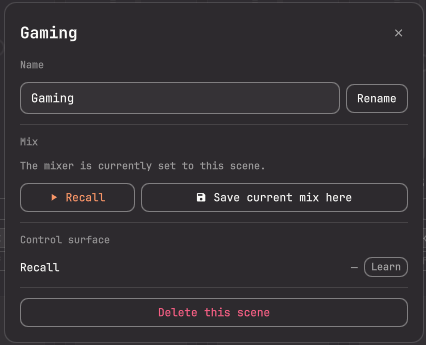

# Pipeworks — Omarchy plugin

A Voicemeeter-style virtual audio mixer for PipeWire, as a single Omarchy shell
plugin. Give every application its own channel, route channels to any of your
outputs, and control it all from the bar, the mixer window, or a MIDI control
surface.



## Install

```sh
omarchy plugin add https://github.com/XenoUniv3rse/pipeworks-omarchy-plugin.git --enable
omarchy bar put pipeworks.mixer --before omarchy.audio
sudo pacman -S python-gobject python-rtmidi
```

Optional extras:

| Package | For |
|---|---|
| `noise-suppression-for-voice lsp-plugins-lv2 swh-plugins` | Microphone and output effects |
| `python-numpy` | The live spectrum in the EQ tuner |

The plugin bundles its daemon and the shell keeps it running — there is no
separate app and no systemd unit. The bar widget tells you if a required
package is missing, with the command to copy, and checks again by itself.

On its first start Pipeworks sets itself up for the machine it is on: one
output (your default speakers or headphones), your default microphone, and the
virtual channels — creating those restarts PipeWire once, so audio blips. New
apps then start in **System**.


## Using it

| Do this | To |
|---|---|
| Left-click the bar icon | Open the fader panel |
| Middle-click the bar icon | Open the mixer window |
| Scroll on the bar icon | Turn the first output up or down (`omarchy bar set pipeworks.mixer scrollStrip "Music"` to pick another strip) |
| Drag an app chip onto a channel | Move that app there — remembered next time it starts |
| Click a channel's ★ | Make it where new apps start (your default sink) |
| Click an output button on a channel | Send that channel to that output |
| Click an output button on an input | Hear yourself through that output |

Strips come in three kinds:

* **Channels** — what apps play into (System, Game, Music…), each with a fader,
  mute, solo, routing, ducking and an EQ.
* **Inputs** — your microphones, republished as one virtual mic for Discord or
  OBS with the mixer's level, mute, effects and EQ applied. Several mics can
  feed one input, each with its own level.
* **Outputs** — your real devices, each with a fader, mute, solo and effects.

Level meters go amber at -12 dBFS and red at -3. The bar icon lights up when
anything is muted; to leave out a strip you keep muted on purpose:
`omarchy bar set pipeworks.mixer mutedIndicatorIgnore "Roof"`.

### Settings

The ⚙ in the window's header holds what applies to Pipeworks as a whole:
whether the window opens **floating** (centred, sized for a mixer) or **tiled**
into your layout, **start on login**, which **control surface** to use, and the
board's **soft takeover** and **on-screen changes**.



### Strip settings

The ⚙ on a strip opens its settings: name, device or microphones, effects,
ducking, and the control-surface bindings.



**Ducking** lowers a channel while another channel or a mic is active — music
dipping when someone talks in Chat, say. The fader does not move; the channel
shows "ducked" and comes back up 0.8 s after the trigger goes quiet.

### EQ

Every channel and input has an **EQ** button next to its ⚙. Each is tuned on
its own.



* **Drag** a numbered band to move it, **scroll** on it to change its width,
  **right-click** to switch it off, **double-click** empty space to add one.
  Or pick a band below the graph and type exact values (`2.5k` works).
* Up to ten bands: bell, low/high shelf, low/high cut, notch, band-pass.
* **Spectrum** shows what the strip is playing — grey before the EQ, coloured
  after. **Tilt** leans it 3 dB per octave so a balanced mix reads flat.
* **Presets**: Flat, Bass boost, Bass cut, Treble boost, Loudness, Vocal
  clarity, Podcast, Gaming footsteps, Cinema, Night mode, Broadcast voice,
  Remove rumble & hum, Warm, Bright — plus your own (★).
* **Preamp** with **Auto**, which lowers it until boosts cannot clip.
* **±6 / ±12 / ±24** sets the graph's range; **On / Bypassed** compares.



On a mic the EQ comes after its effects, so it is in what your call hears.
Moving a band is instant and silent; changing a band's type, switching one off,
or bypassing restarts that strip's processing — a brief blip.

### Effects

**Inputs**: noise suppression, high-pass, gate, compressor, three-band tone,
reverb. **Outputs**: high-pass, compressor, tone, limiter — they process
everything played through that device, so speakers and headphones can be tuned
apart. Sliders are live; switching an effect on blips that strip.



If an effect's plugin package is missing, that strip carries on without it and
the window says so.

### Scenes

A scene saves every level, mute, solo and route under a name. **Save scene** in
the window; click a scene (or its button in the bar panel) to recall it. The
scene matching the live mix is highlighted. Its ⚙ renames, updates, deletes,
or binds it to a button on the board.



Scenes leave strips, devices and effects alone. With MIDI-only volume on, a
scene recalled from the screen restores everything except levels.

### Control surface

Pick your board in **Settings** (the ⚙ in the header), then use **Learn** in
any strip's settings and move the control you want.

No board — on a laptop, say? Choose **Keyboard (volume keys)** instead and pick
which strip the keys adjust (the first output unless you choose another). Volume
up and down move it 5%, 1% with Alt, and Mute mutes it, with the usual OSD.
Pipeworks takes the keys over in Hyprland only while Keyboard is chosen — your
config is never edited, and choosing a board again gives them back. Buttons light
their LEDs on boards that have them.

* The ✕ next to a binding clears it. Learning a control that is already bound
  moves it, and the window says from where.
* Bindings remember the MIDI channel, so boards with layers work.
* **MIDI-only volume** (the lock in the window header, or the button at the
  bottom of the bar panel) stops software from
  moving levels; faders go dim. Mute, solo and routing still work.
* **Soft takeover** (in Settings, on by default): after a level changes on screen, a
  physical fader does nothing until you bring it to that level, so levels
  never jump.
* **Show changes on screen** (in Settings, on by default): the board's moves appear on the
  shell's OSD — "Music 45%", "Chat muted", or "Game: move up to 70%" for a
  fader waiting to take over.

## Reference

### Scripting

Everything the window does is an `org.gtk.Actions` call on the session bus, so
it can be scripted or bound to a key:

```sh
gdbus call --session --dest io.github.pipeworks.Pipeworks \
  --object-path /io/github/pipeworks/Pipeworks \
  --method org.gtk.Actions.Activate "toggle-mute" "[<'music'>]" "{}"
```

| Group | Actions |
|---|---|
| Levels and switches | `set-volume (sd)`, `set-output-volume (sd)`, `toggle-mute s`, `toggle-output-mute s`, `toggle-solo s`, `toggle-output-solo s`, `toggle-route (ss)`, `set-volume-lock b`, `toggle-volume-lock`, `set-soft-takeover b`, `set-midi-osd b`, `set-duck (ssd)`, `set-window-floating b` |
| Scenes | `save-scene s`, `update-scene s`, `rename-scene (ss)`, `remove-scene s`, `recall-scene s` |
| Apps | `move-stream (is)`, `set-default-channel s` |
| Strips | `add-channel s`, `add-input (ss)`, `add-output (ss)`, `remove-strip (ss)`, `rename-strip (sss)`, `retarget-input (ss)`, `retarget-output (ss)` |
| Microphones | `add-input-source (ss)`, `remove-input-source (ss)`, `set-input-source-volume (ssd)` |
| EQ | `set-eq (ss)`, `save-eq-preset (ss)`, `remove-eq-preset s` |
| Effects | `set-effect-enabled (ssb)`, `set-effect-control (sssd)` |
| Control surface | `midi-learn (ss)`, `midi-learn-cancel`, `midi-unbind (ss)`, `set-midi-port s`, `use-keyboard`, `set-keyboard-target s`, `keyboard-volume s` |
| Housekeeping | `set-autostart b`, `set-state-watch b`, `show-window`, `quit` |

Strips are addressed by id (`music`, `mic`, `master`…), scenes by the id made
from their name (`Gaming` → `gaming`, kept if renamed). `set-duck` takes a
channel, a trigger strip (`''` for off) and an amount in percent. `set-eq`
takes a strip and its whole EQ as JSON:

```sh
gdbus call --session --dest io.github.pipeworks.Pipeworks \
  --object-path /io/github/pipeworks/Pipeworks \
  --method org.gtk.Actions.Activate "set-eq" \
  "[<('music', '{\"enabled\": true, \"preamp\": -4, \"bands\": [{\"type\": \"lowshelf\", \"freq\": 100, \"gain\": 4, \"q\": 0.7}]}')>]" "{}"
```

The window can open straight to a dialog:
`omarchy-shell shell summon pipeworks.mixer '{"eq":"music"}'` — also
`{"settings":{"kind":"channel","id":"game"}}`, `{"scene":"new"}` or
`{"preferences":true}`.

### Files

| Path | What |
|---|---|
| `~/.config/pipeworks/config.json` | Strips, routing, levels, effects, EQs, scenes, bindings |
| `~/.config/pipeworks/state.json` | What the window reads: running apps, devices, Learn progress (refreshed only while a window is watching) |
| `~/.config/pipeworks/effects/` | One generated filter-chain config per strip with effects or an EQ |
| `~/.config/pipewire/pipewire.conf.d/10-pipeworks.conf` | The virtual channels and mics; rewritten when one is added or removed, which restarts PipeWire |

### How it works

The daemon (`daemon/`, Python) owns the audio and draws nothing; the bar
widget and the window are QML in the Omarchy shell, so they follow your theme.
The shell's `Service.qml` keeps the daemon running, judging it alive by its
name on the session bus. Closing the window stops nothing but the meters.

Each strip with effects or an EQ runs its own `pipewire -c` filter chain, so
switching something on restarts that strip alone, never the audio server.
Sliders, EQ bands and preamps are live controls on the running chain. Chains
that fail to start are bypassed rather than leaving a strip silent, and a
watchdog relinks anything PipeWire drops.

The EQ curve uses PipeWire's own biquad formulas, checked against measured
responses of the real filters. PipeWire treats a shelf's Q as a true Q: 0.7 is
a plain shelf, higher adds a bump at the corner. The spectrum is
`daemon/spectrum.py` — an 8192-point FFT at about 30 frames a second, running
only while the tuner is open.

Ducking listens with one small `pw-record` per trigger strip in use, and only
while some channel ducks. Mic levels set in an input's settings are the
devices' own, so they apply everywhere that microphone is used.

```
Service.qml        keeps the daemon running
MixerWidget.qml    the bar icon and fader panel
MixerWindow.qml    the mixer window
MixerModel.qml     state and actions shared by both
MixerStrip.qml     one strip as a card          StripGroup.qml   a row of them
StripSettings.qml  a strip's settings dialog    SceneSettings.qml  a scene's
GlobalSettings.qml the ⚙ Settings dialog
EqTuner.qml        the EQ tuner                 EqMath.js        its curve maths
LearnRow.qml       one MIDI Learn row           AddStrip.qml     add a strip
daemon/run.py      the daemon                   daemon/spectrum.py  EQ spectrum
daemon/window_mode.py  floats or tiles the window in Hyprland
daemon/pipeworks/  mixing, PipeWire, MIDI, effects, EQ, ducking, published state
```

## License

MIT
